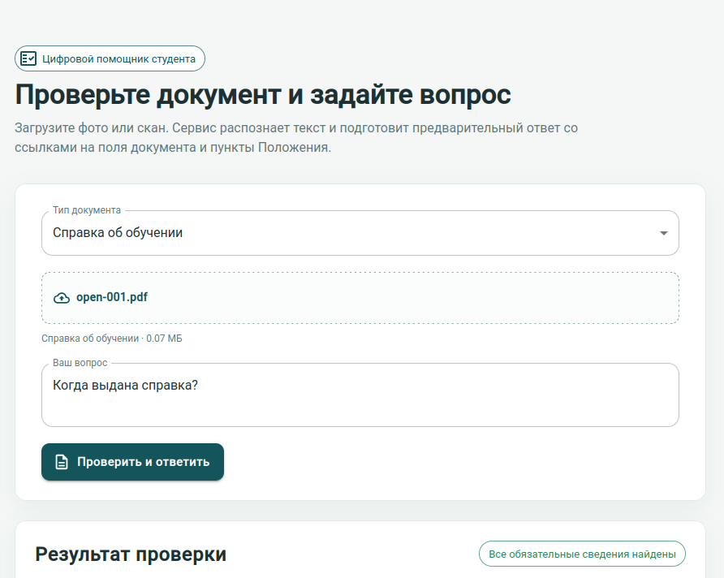
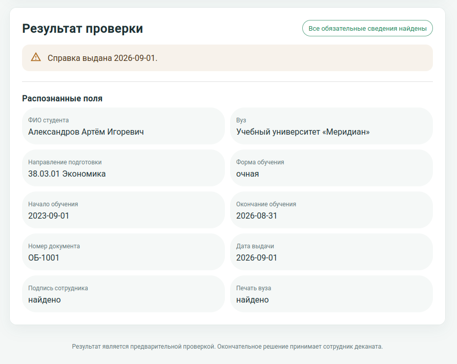
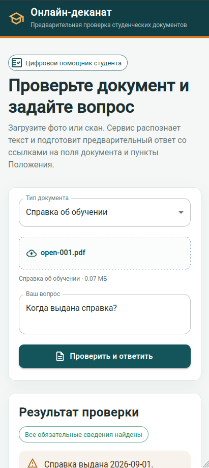
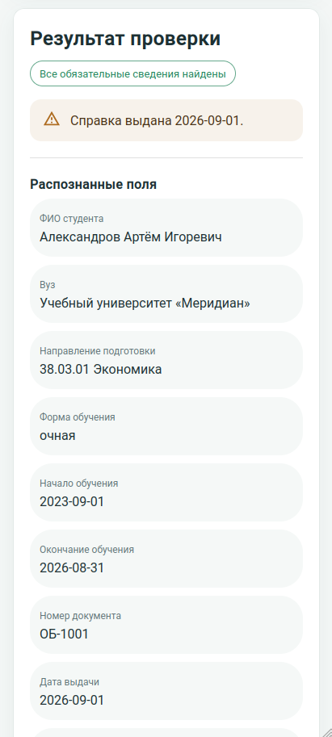

# Dekan-AI: Онлайн деканат
## Стек
Выполнено в трех контейнерах:
- серверная часть — Python 3.12, FastAPI, собственно PyTecceract;
- фронт — NGINX, NodeJS, React с оформлением под Material;
- LLM — Ollama с qwen2.5:3b

## Запуск решения

**Для запуска потребуется Docker/Podman Compose**

1. Перейти в корень каталога с проектом
2. Из корня проекта выполнить команду:
```shell
# Docker
docker compose up --build 
# Podman
podman compose up --build 
```

3. Перейти по адресу http://localhost:8080


## Скриншоты
Настольная версия



Мобильная версия


